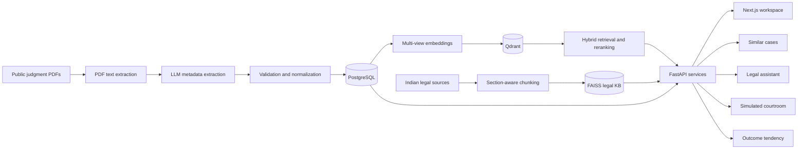
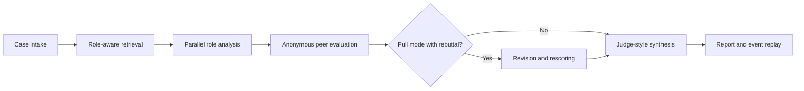

# NyayaAI

**Evidence-grounded legal intelligence for Indian case-law research.**

NyayaAI turns unstructured court judgments into a searchable, explainable legal
research workspace. It combines a 10,000+ case corpus, semantic precedent
retrieval, a citation-oriented legal assistant, a multi-role simulated
courtroom, and historical outcome-tendency analysis in one application.

> NyayaAI is a research and decision-support system. It is not legal advice,
> does not replace qualified counsel, and must not be treated as an automated
> judge or a definitive source of law.

## Project Snapshot

| Measure | Evaluated project snapshot |
| --- | ---: |
| Structured case records | 10,005 |
| Non-invalid cases indexed | 9,616 |
| Judgment vector collections | 4 |
| Legal knowledge-base chunks | 5,752 |
| Full-text field presence | 100% |
| Average extraction confidence | 76.57% |
| Judgment years represented | 2012-2025 |
| Documented backend test milestone | 124 passing |

The corpus figures come from the local generated reports
`nyaya-ai/data/processed/production_readiness_report.json` and
`nyaya-ai/data/processed/index_integrity_report.json`; the corpus snapshot was
generated on 12 March 2026. Generated reports and large data assets are not
committed to Git. The 76.57% value is model-reported extraction confidence, not
human-verified metadata or legal accuracy. Most records remain flagged for
review under the project's conservative validation rules.

## Why NyayaAI

Court judgments contain facts, arguments, statutes, precedents, reasoning, and
outcomes, but these elements are usually buried in long PDFs. Keyword search
alone struggles when two cases describe similar legal or factual issues using
different language. General-purpose chatbots introduce a different risk: fluent
answers without reliable source grounding.

NyayaAI addresses this with a traceable pipeline:

1. Acquire public judgments and extract their full text.
2. Convert each judgment into structured legal metadata.
3. Validate, normalize, deduplicate, and store the result.
4. Build multiple semantic representations of every usable case.
5. Retrieve and rerank related judgments with explanation signals.
6. Ground research answers in a separately indexed legal knowledge base.
7. Examine case material through competing legal roles and peer critique.
8. Report historical tendencies with uncertainty and bias indicators.

## Features

### Similar Case Retrieval

- Search with pasted legal text, an uploaded PDF or DOCX, or an existing case.
- Compare factual, legal, combined, and full-text similarity.
- Filter by court, case type, verdict, and year range.
- Blend dense retrieval with lexical signals and cross-encoder reranking.
- Explain results using statutory overlap, case type, court, outcome, and time.
- Inspect full case details and compare selected cases side by side.
- Export result sets as JSON or CSV.

### Legal Research Assistant

- Retrieve from a section-aware Indian legal knowledge base.
- Work with uploaded context or an existing case.
- Prompt the model to answer only from retrieved evidence and return numbered
  citations.
- Return retrieval support, confidence indicators, warnings, and disclaimers.
- Cover constitutional, current and legacy criminal, civil, procedural, and
  selected regulatory materials.

### Simulated Courtroom

- Run a quick analysis with Prosecution, Defense, and Legal Analyst roles.
- Add a Constitutional Expert and optional rebuttal in full mode.
- Retrieve role-specific legal context before argument generation.
- Score each role anonymously across a fixed six-criterion rubric.
- Revise arguments from peer critique and rescore them.
- Produce a judge-style synthesis of consensus, disagreement, and unresolved
  issues.
- Retain structured trial events and provider/model provenance for process-local
  replay.

The current courtroom is an engineering baseline. Execution is synchronous,
runs and replay history are held in process memory and disappear on restart,
and the synthesizer is a single judge-style route rather than the full planned
multi-judge panel.

### Outcome Tendency Analysis

- Build historical cohorts from non-invalid cases with recorded verdicts.
- Show outcome distributions, sentence summaries, and recent trends.
- Return confidence bands and reliability notes.
- Surface explainability signals and basic disparity or drift warnings.
- Benchmark offline classifiers, including logistic regression, random forest,
  and calibrated logistic regression.

This feature describes historical patterns. It is deliberately not presented
as a verdict predictor.

## Architecture



### Data and Retrieval Layers

| Layer | Responsibility |
| --- | --- |
| PostgreSQL | Authoritative case metadata, full text, validation, statutes, and precedents |
| Qdrant | 3,072-dimensional judgment vectors for combined, factual, legal, and full-text retrieval |
| FAISS | Separate legal-reference and statutory knowledge-base index |
| Redis | Local infrastructure dependency reserved for caching and coordination |

Judgment embeddings use OpenAI `text-embedding-3-large`. The combined vector is
a normalized blend of factual, legal, and outcome representations. Search can
then combine vector similarity, BM25-style lexical evidence, metadata filters,
and `cross-encoder/ms-marco-MiniLM-L-6-v2` reranking.

The legal knowledge base uses `multi-qa-mpnet-base-dot-v1` embeddings and is
kept separate from the judgment index so statutory evidence and case precedent
remain distinct retrieval sources.

## Simulated Courtroom Workflow



The peer-evaluation rubric is fixed and transparent:

| Criterion | Weight |
| --- | ---: |
| Legal accuracy | 25% |
| Constitutional alignment | 20% |
| Logical coherence | 20% |
| Precedent usage | 15% |
| Fairness and balance | 10% |
| Practical applicability | 10% |

The design is intended to reduce single-perspective reasoning by separating
advocacy roles, preventing self-scoring, adding an explicit correction cycle,
and requiring the final synthesis to expose disagreement rather than hiding it.

## Technology Stack

| Area | Technologies |
| --- | --- |
| Data pipeline | Python, Boto3, pdfplumber, PyPDF2 |
| LLM integration | OpenAI, Google Gemini, Groq, Anthropic client support |
| API | FastAPI, Pydantic, SQLAlchemy, Uvicorn |
| Data stores | PostgreSQL/pgvector image, Qdrant, FAISS, Redis |
| Retrieval and ML | OpenAI embeddings, Sentence Transformers, scikit-learn, pandas, NumPy |
| Frontend | Next.js 16, React 19, TypeScript, Tailwind CSS 4 |
| Client state | TanStack Query, Zustand |
| UI and motion | Radix Slot, Framer Motion, Lucide React |
| Infrastructure | Docker Compose |
| Quality | pytest, evaluation harnesses, integrity manifests, benchmark reports |

## Repository Layout

```text
nyaya-ai/
├── src/
│   ├── api/                    # FastAPI application and middleware
│   ├── config/                 # Environment-backed settings
│   ├── data_pipeline/          # Download, extraction, validation, and loading
│   ├── database/               # SQLAlchemy models and Pydantic schemas
│   └── features/
│       ├── similar_cases/      # Embeddings, Qdrant search, reranking, explanations
│       ├── legal_assistant/    # Legal-KB retrieval and citation-aware responses
│       ├── courtroom/          # Roles, scoring, rebuttal, synthesis, and events
│       └── outcome_tendency/   # Cohorts, statistics, calibration, and bias audit
├── frontend/                   # Next.js application
├── legal_kb/                   # Legal source manifest, chunks, embeddings, and FAISS assets
├── scripts/                    # Pipeline, indexing, evaluation, and maintenance commands
├── tests/                      # Backend unit and API-contract tests
├── data/processed/             # Generated readiness and evaluation reports
├── docs/                       # Internal notes, plans, runbooks (local-only, not committed)
├── docker-compose.yml          # PostgreSQL, Redis, Qdrant, and PgAdmin
└── requirements.txt            # Pinned Python dependencies
```

## Quick Start

### Prerequisites

- Python 3.10+
- Node.js and npm
- Docker with Docker Compose
- An OpenAI API key for embedding and search flows
- Optional Gemini and Groq keys for broader courtroom provider routing

The commands below use Linux/macOS shell syntax. On Windows, activate the
virtual environment with `venv\Scripts\activate`.

### 1. Install the backend

Enter the application directory from the repository root:

```bash
cd nyaya-ai
python -m venv venv
source venv/bin/activate
pip install -r requirements.txt
cp .env.template .env
```

Edit `.env` and set at least:

```dotenv
OPENAI_API_KEY=your_openai_key
```

Never commit `.env` or real API credentials.

### 2. Start local infrastructure

```bash
docker-compose up -d
docker-compose ps
```

This starts PostgreSQL on `5432`, Redis on `6379`, Qdrant on `6333/6334`,
and PgAdmin on `5050`.

### 3. Initialize the database

```bash
PYTHONPATH=. venv/bin/python -c "from src.data_pipeline.loaders.db_loader import DatabaseLoader; DatabaseLoader().init_db()"
```

### Data availability

A fresh clone starts with an empty PostgreSQL database and empty judgment
collections in Qdrant. The tracked repository includes legal-KB chunks and the
FAISS legal-KB index, but it does not include the 10,005-case database, raw PDF
corpus, or generated Qdrant data.

To use similar-case search, either restore database/vector snapshots supplied by
the project team or build a local corpus with the commands in
[Data Pipeline](#data-pipeline), then generate the judgment indexes. The metrics
in this README describe the evaluated project environment and are not recreated
by schema initialization alone.

### 4. Start the API

```bash
PYTHONPATH=. venv/bin/uvicorn src.api.main:app --reload --host 0.0.0.0 --port 8000
```

Verify the API:

```bash
curl http://localhost:8000/health
```

Interactive API documentation is available at
[`http://localhost:8000/docs`](http://localhost:8000/docs).

### 5. Start the frontend

In another terminal, starting from the repository root:

```bash
cd nyaya-ai/frontend
cp .env.example .env.local
npm install
npm run dev
```

Open [`http://localhost:3000`](http://localhost:3000).

### 6. Stop the services

Run from the `nyaya-ai/` application directory:

```bash
docker-compose down
```

## Data Pipeline

To build a small corpus locally:

```bash
python scripts/01_download_sample.py
python scripts/03_run_extraction.py
python scripts/04_validate_quality.py
```

The main production pipeline follows:

```text
Download -> PDF extraction -> LLM metadata extraction -> validation
         -> PostgreSQL loading -> court standardization -> deduplication
         -> embedding generation -> index integrity verification
```

Important implementation details:

- `PDFExtractor.extract_text()` returns a result dictionary containing
  `success`, `text`, `page_count`, method, and error information.
- Long judgments are reduced to their first 15,000 and last 5,000 characters
  for metadata extraction.
- Validation results are stored as `valid`, `needs_review`, or `invalid`.
- Only non-invalid cases are included in the judgment vector indexes.
- The current pipeline has no OCR path for scanned-image PDFs.
- API use incurs provider costs. Keep experimental batches small.

### Rebuild Judgment Indexes

Only run these commands against a populated database when Qdrant is empty or an
index rebuild is required:

```bash
PYTHONPATH=. venv/bin/python scripts/13_generate_embeddings.py --yes --batch-size 32
PYTHONPATH=. venv/bin/python scripts/14_generate_fulltext_embeddings.py --yes --batch-size 32
PYTHONPATH=. venv/bin/python scripts/18_sync_vector_index.py
PYTHONPATH=. venv/bin/python scripts/19_rebuild_embedding_manifest.py
PYTHONPATH=. venv/bin/python scripts/16_verify_index_integrity.py
```

## API Overview

| Capability | Representative endpoints |
| --- | --- |
| Health | `GET /health` |
| Similar-case search | `POST /api/v1/cases/similar` |
| Document search | `POST /api/v1/cases/similar/upload` |
| Case details | `GET /api/v1/cases/{case_id}` |
| Existing-case similarity | `GET /api/v1/cases/{case_id}/similar` |
| Search explanation | `POST /api/v1/cases/explain` |
| Assistant sessions | `POST /api/v1/assistant/session` |
| Assistant query | `POST /api/v1/assistant/query` |
| Courtroom analysis | `POST /api/v1/courtroom/analyze` |
| Courtroom report | `GET /api/v1/courtroom/analysis/{analysis_id}` |
| Courtroom events | `GET` or `WebSocket /api/v1/courtroom/analysis/{analysis_id}/events` |
| Outcome tendency | `POST /api/v1/cases/tendency` |

Use the generated OpenAPI documentation for complete request and response
schemas.

## Evaluation Results

### Retrieval

The latest local heuristic evaluation contains 200 queries:

| Metric | Score |
| --- | ---: |
| Precision@10 | 0.3519 |
| Recall@20 | 0.4839 |
| MRR@10 | 0.5671 |
| nDCG@10 | 0.4103 |
| Warm default p95 latency | 2,394 ms |

These figures pass the project's heuristic engineering gate. The relevance set
was generated from corpus metadata and is not a substitute for lawyer-judged
retrieval evaluation. Human annotation tooling exists, but production sign-off
is still pending.

### Legal Assistant

The current smoke report contains five questions and records citations in every
response. It measures citation presence and retrieval behavior, not claim-level
citation correctness, hallucination rate, or expert-rated legal accuracy.

### Simulated Courtroom

| Measure | Recorded value |
| --- | ---: |
| Evaluated runs | 6 |
| Runs returning a report | 100% |
| Degraded runs | 33.3% |
| Average consensus meter | 0.892 |
| Average synthesis confidence | 0.852 |

The consensus meter represents score spread, not agreement on the legal outcome.
The evaluated runs also include retrieval and provider warnings, so these
figures demonstrate workflow resilience rather than verified legal correctness.

### Outcome Tendency Benchmark

The offline benchmark scanned 9,537 labelled rows. The best recorded random
forest result is shown below. This report was generated on 8 April 2026.

| Metric | Score |
| --- | ---: |
| Accuracy | 0.6478 |
| Macro-F1 | 0.3223 |
| Brier score | 0.0589 |

The class distribution is highly imbalanced. These metrics are a research
baseline and must not be interpreted as the probability that a new matter will
receive a particular judgment.

## Testing and Quality Checks

Run the following commands from the `nyaya-ai/` application directory.

Run the backend test suite:

```bash
PYTHONPATH=. venv/bin/pytest tests/ -q
```

Run the frontend lint check:

```bash
npm --prefix frontend run lint
```

Verify database and vector-index consistency from the `nyaya-ai/` application
directory:

```bash
PYTHONPATH=. venv/bin/python scripts/16_verify_index_integrity.py
```

Optional evaluation commands:

```bash
PYTHONPATH=. venv/bin/python scripts/17_eval_retrieval_quality.py --max-queries 200
PYTHONPATH=. venv/bin/python scripts/15_benchmark_search.py --quick
PYTHONPATH=. venv/bin/python scripts/33_eval_assistant_quality.py
PYTHONPATH=. venv/bin/python scripts/39_eval_courtroom_quality.py
PYTHONPATH=. venv/bin/python scripts/40_benchmark_tendency_models.py
PYTHONPATH=. venv/bin/python scripts/41_eval_tendency_quality.py
```

Some evaluations call external model providers and may incur cost or fail under
provider quotas.

## Project Status

| Phase | Status |
| --- | --- |
| 1. Data Foundation | Complete |
| 2. Similar Case Retrieval | Engineering-complete; production sign-off pending |
| 3. Legal Research Assistant | Complete |
| 4. Simulated Courtroom | Engineering-complete; production sign-off pending |
| 5. Outcome Tendency Analyzer | Complete |
| 6. Integration and Launch | Not started |

The authoritative phase record is maintained locally at
`nyaya-ai/docs/notes/PROJECT_STATUS.md`. Internal engineering docs and older
phase snapshots under `nyaya-ai/docs/` are kept local-only and are not committed
to this repository. These labels describe delivery
against the engineering phase plans; they are not independent certification of
legal accuracy or production readiness.

### Next Priorities

- Complete lawyer-judged retrieval evaluation.
- Validate citation entailment and substantive legal claims.
- Add input privacy controls, authentication, and tenant isolation.
- Move courtroom execution to an asynchronous, durable run model.
- Persist courtroom reports and event histories in PostgreSQL.
- Add stronger monitoring, deployment packaging, and CI workflows.
- Calibrate confidence against human-reviewed legal outcomes.
- Complete Phase 6 integration and launch hardening.

## Known Limitations

- Extraction confidence is generated by the extraction pipeline and is not
  independently verified field accuracy.
- Most corpus records are marked `needs_review`; only a small subset passes all
  validation checks without warnings.
- Similar-case relevance has not completed human-lawyer sign-off.
- Legal-assistant citations are evidence labels, but claim-level support is not
  yet comprehensively validated.
- The courtroom does not currently redact sensitive input before third-party
  model calls.
- Courtroom status, replay, caching, and cancellation are process-local.
- Courtroom cost values are estimates rather than provider billing records.
- Outcome cohorts are descriptive and can inherit corpus imbalance.
- The online outcome endpoint does not yet serve the offline benchmark model as
  a production prediction service.
- Local Docker defaults are development settings and are not production
  hardened.

## Research References

1. I. Chalkidis et al., "LexGLUE: A Benchmark Dataset for Legal Language
   Understanding in English," *ACL*, 2022.
   [doi:10.18653/v1/2022.acl-long.297](https://doi.org/10.18653/v1/2022.acl-long.297)
2. P. Henderson et al., "Pile of Law: Learning Responsible Data Filtering from
   the Law and a 256GB Open-Source Legal Dataset," *NeurIPS*, 2022.
   [doi:10.52202/068431-2119](https://doi.org/10.52202/068431-2119)
3. H. Li et al., "SAILER: Structure-Aware Pre-trained Language Model for Legal
   Case Retrieval," *ACM SIGIR*, 2023.
   [doi:10.1145/3539618.3591761](https://doi.org/10.1145/3539618.3591761)
4. N. Guha et al., "LegalBench: A Collaboratively Built Benchmark for Measuring
   Legal Reasoning in Large Language Models," *NeurIPS*, 2023.
   [doi:10.52202/075280-1915](https://doi.org/10.52202/075280-1915)
5. M. Medvedeva and P. McBride, "Legal Judgment Prediction: If You Are Going to
   Do It, Do It Right," *NLLP*, 2023.
   [doi:10.18653/v1/2023.nllp-1.9](https://doi.org/10.18653/v1/2023.nllp-1.9)
6. Z. Fei et al., "LawBench: Benchmarking Legal Knowledge of Large Language
   Models," *EMNLP*, 2024.
   [doi:10.18653/v1/2024.emnlp-main.452](https://doi.org/10.18653/v1/2024.emnlp-main.452)
7. J. Niklaus et al., "MultiLegalPile: A 689GB Multilingual Legal Corpus,"
   *ACL*, 2024.
   [doi:10.18653/v1/2024.acl-long.805](https://doi.org/10.18653/v1/2024.acl-long.805)
8. H. Li et al., "LeCaRDv2: A Large-Scale Chinese Legal Case Retrieval
   Dataset," *ACM SIGIR*, 2024.
   [doi:10.1145/3626772.3657887](https://doi.org/10.1145/3626772.3657887)
9. G. Sukanya and J. Priyadarshini, "Enhanced Hybrid Deep Learning Model With
   Improved Self-Attention Mechanism for Legal Judgment Prediction,"
   *IEEE Access*, 2025.
   [doi:10.1109/ACCESS.2025.3596180](https://doi.org/10.1109/ACCESS.2025.3596180)
10. B. Park and K. Seo, "Assessing Critical Thinking through a Multi-Agent
    LLM-Based Debate Chatbot," *CHI Extended Abstracts*, 2025.
    [doi:10.1145/3706599.3721207](https://doi.org/10.1145/3706599.3721207)

## Documentation

- [System architecture diagram](diagram.md) — rendered Mermaid map of the
  full stack, protocol flows, and single-pass execution boundaries.
- Internal engineering documentation (phase status, runbooks, plans, meeting
  notes, and archived phase reports) lives under `nyaya-ai/docs/` and is
  intentionally kept local-only via `.gitignore`; it is not distributed with
  this repository.

## Responsible Use

Always verify cited material against the official judgment, statute, rule, or
other primary legal source. Do not upload confidential or personally sensitive
case material to a deployment that has not been reviewed for privacy,
authentication, data retention, and third-party model-provider handling.
